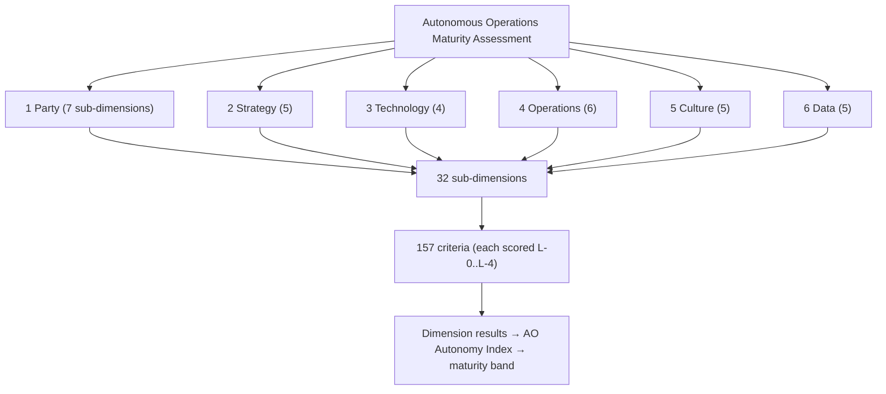
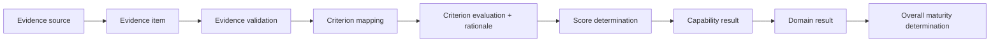

# Autonomous Operations Maturity Model

**`dea:maturity-autonomous-operations`** — an enterprise maturity and assessment model for
**Autonomous Operations (AO)**: the operating model in which an organization's value streams are
instrumented with AI, data and **closed-loop control**, so that agents and autonomous systems
**learn, self-govern and self-adapt** — with **intent and goals driving the closed loops**
(Observe → Orient → Decide → Act) — progressively shifting the burden of decisions and execution
from humans to machines, under designed human oversight.

> **Model release:** `1.0.1` · **stable** · scored on the canonical v2 bands
> (`dea:maturity-bands-v2` v1.0.0, `technehub-labs/dea-metamodel`).
> **Repository-standard conformance:** this repository is the reference implementation of
> `docs/REPO-STANDARD.md` (CR-AM-12). Model release status and repository conformance are
> separate labels: the *model* is stable; the *repository* conforms to the ecosystem standard.

---

## 1. Overview

The model assesses an organization's **ability to design, govern, operate and continuously
improve autonomous operations** across its value streams — not the quantity of AI technology
deployed. It covers six dimensions (Party, Strategy, Technology, Operations, Culture, Data),
32 sub-dimensions and **157 assessment criteria**, each scored on a five-level scale and
aggregated into an **AO Autonomy Index (0–100)** resolved to a maturity band.

Machine-readable artifacts are authoritative; this README explains them (ADR-AM-12-04):

| Artifact | Role |
|---|---|
| `maturity/model/autonomous-operations.yaml` | Criteria register (dimensions → sub-dimensions → criteria) — **authoritative** |
| `maturity/scale.yaml` | The 5-level maturity scale (bound to the canonical upstream instance) |
| `maturity/evaluation.yaml` | Scoring model + assessment method |
| `maturity/assessment-questionnaire.yaml` | Assessment instrument (one entry per criterion) |
| `model.yaml` | Repository manifest + contract handshake (CR-AM-11 §15) |

## 2. Why autonomous operations maturity matters

Modern operations are too fast, too distributed and too data-heavy for human-paced, step-by-step
control to remain the default. Value is lost in the gaps between detecting an event, deciding
what to do, and doing it. AO closes those gaps with instrumented, goal-driven feedback loops —
converting operations from a cost center into a self-correcting, value-generating system.
Expected outcomes: faster and more predictable service delivery, lower operational cost, better
customer and party experience, safer autonomous action (guardrails + audit), and measurable,
ecosystem-visible value.

## 3. Model purpose and scope

**Subject vs. maturity.** The model assesses the *organization's maturity at realizing*
autonomous operations — its capabilities, governance and operating practices — not the abstract
concept itself.

**In scope:** any organization, operating environment or value stream (B2B, B2C, B2B2X, internal
operations; comms providers, digital service providers, enterprises, industry verticals) —
assessed per value stream/scenario and rolled up organization-wide.

**Out of scope / boundaries:** this is a whole-operating-model model. Adjacent subjects — digital
transformation strategy, general AI adoption, task automation, or narrower domain-specific
autonomy ladders for individual technology domains — are covered by sibling models in the
ecosystem (see §12). AO is not "more of the same": it is the operating model *in which* those
domain capabilities compose into closed loops.

## 4. Conceptual foundations

- **Automation ≠ autonomy.** Automation executes predefined rules faster. Autonomy means the
  system perceives, orients, decides and acts toward a goal within governance constraints.
- **Closed-loop control (OODA).** Every assessed loop is Observe → Orient → Decide → Act.
  Progression levels are defined by *who owns each OODA stage* (see §6).
- **Intent/goals drive the loops.** Humans (or partner systems) express intent; the system
  decomposes and fulfils it. Intent is the "what", not the "how".
- **Agents.** Software agents are production assets with a lifecycle (onboard, version, monitor,
  roll back, kill-switch) and policy guardrails; every autonomous action is logged and auditable.
- **Human–machine working model.** Humans set intent and policy, oversee, audit and handle
  exceptions; machines do the routine cognitive work. Oversight is designed, not improvised.
- **Learning.** Loops feed back into behavior: the system learns and self-adapts continuously.

## 5. Model architecture

Assessment hierarchy (actual identifiers from the register):



| Dimension | Focus | Sub-dims | Criteria |
|---|---|---|---|
| 1 Party | Customer/partner/employee/thing engagement, experience, insight, trust | 7 | 41 |
| 2 Strategy | Value model, business architecture, financial management, governance, sustainability | 5 | 22 |
| 3 Technology | Autonomy capabilities, architecture, resources, lifecycle | 4 | 22 |
| 4 Operations | Closed-loop flows: anomaly, assurance, complaints, value uplift, net-zero, fulfillment | 6 | 25 |
| 5 Culture | Innovation, quality, culture management, alignment, workplace enablement | 5 | 19 |
| 6 Data | Lifecycle, quality, security, governance, value realization | 5 | 26 |

Criteria marked `gating: true` (the closed-loop spine 4.1.1–4.1.4: detect → root-cause → decide →
act) cap the organization's band — a loop that cannot act cannot make the organization autonomous.

## 6. Maturity levels

The scale (`maturity/scale.yaml`) has five levels L-0…L-4; scoring resolves the index to the
**canonical v2 bands** (`dea:maturity-bands-v2`). Each level carries an AO stage name
(`ao_stage_by_ordinal` in the register) describing the ambition it represents.

| Scale level | AO stage | Canonical band (v2) | Score range (inclusive) | Integer scores in range | Effort multiplier |
|---|---|---|---|---|---|
| L-0 Absent | Manual & Reactive | `level-1-emergent` Emergent | 0–20 | 21 | 1.0× |
| L-1 Initial | Instrumented & Assisted | `level-2-structured` Structured | 21–45 | 25 | 1.5× |
| L-2 Defined | Closed-Loop Automated | `level-3-systematic` Systematic | 46–70 | 25 | 2.5× |
| L-3 Automated | Goal-Driven Autonomy | `level-4-adaptive` Adaptive | 71–88 | 18 | 4.0× |
| L-4 Autonomous | Self-Improving Ecosystem | `level-5-self-optimising` Self-Optimising | 89–100 | 12 | 6.0× |

*Width note (resolved):* ranges are **inclusive**, so "width" = number of integer scores =
`hi − lo + 1` (21/25/25/18/12); the bands partition 0–100 exactly. *Effort multiplier (resolved):*
it is a **planning/cost signal** — the relative organizational effort of earning one point within
that band, normalised to the lowest band = 1.0× (superlinear, reflecting diminishing returns).
It is **not** a score multiplier; the effort-adjusted value is `index × multiplier of the resolved
band` (see §9).

**What changes between levels** (OODA ownership is the progression axis):

| Level | Operating behavior | Governance | Human role | Loop closure |
|---|---|---|---|---|
| L-0 Manual & Reactive | Human-driven, reactive; no feedback loop | None | Humans perform every OODA stage | Open |
| L-1 Instrumented & Assisted | Telemetry exists; tools assist; humans decide/approve | Documented, partial enforcement | Humans orient/decide; machines observe & run scripted actions | Partial |
| L-2 Closed-Loop Automated | Loops run across most in-scope flows; SLOs/error budgets enforced | Formal, tooling-enabled | Humans set goals/SLOs, handle exceptions; system decides within rules | Closed, measured |
| L-3 Goal-Driven Autonomy | Agents decide/act within guardrails; multi-agent coordination; simulation-before-act | Guardrails + audit enforced automatically | Humans set intent/policy, oversee, audit | Closed autonomous |
| L-4 Self-Improving Ecosystem | Self-learning loops across the ecosystem; intent negotiated with partners | Self-governing, continuously improving | Humans govern, set ultimate values, audit | Self-learning, ecosystem-wide |

## 7. Assessment methodology


**Roles:** assessor (independent of the team that produced the evidence — self-attestation alone
caps confidence at Medium), assessment subject, evidence owner, reviewer. Required inputs: scope
charter, evidence pack per criterion, stakeholder interviews, telemetry access, baseline/target,
roadmap. Cadence: quarterly recommended, or event-driven after major loop/agent changes. Full
method: `maturity/evaluation.yaml` → `assessment`; instrument: `maturity/assessment-questionnaire.yaml`.

## 8. Evidence framework

Every determination must be traceable back to evidence:



Evidence types per dimension are listed in the questionnaire (`evidence_to_request`); provenance,
validation and sufficiency are recorded per item; confidence levels (High ≥80% independently
verified, Medium 50–79%, Low <50%) are reported with every result.

## 9. Scoring and maturity determination

1. **What is scored:** each of the 157 criteria, on scale level L-0…L-4 → points = band upper edge
   (L-0=20, L-1=45, L-2=70, L-3=88, L-4=100). Unassessed criteria score 0 and lower confidence.
2. **Aggregation:** dimension score = mean of its criteria → **AO Autonomy Index** = weighted mean
   of dimension scores. Weights are declared in `maturity/evaluation.yaml`
   (`dimension_weights` = default profile; `weight_profiles` adds `comms-provider`); the profile is
   chosen in the scope charter and recorded in the result.
3. **Band determination:** the index resolves to a canonical v2 band (§6). **Weakest-link gate:** the
   org band cannot exceed the band of the lowest *in-scope* gating criterion (4.1.1–4.1.4);
   scope-excluded criteria do not gate.
4. **Effort-adjusted value** = index × effort multiplier of the resolved band (diminishing returns
   made explicit for portfolio decisions).

## 10. Worked example

See `examples/autonomous-operations-2026.yaml`: dimension scores 60/72/68/74/66/68 →
**AO Autonomy Index 68 → band `level-3-systematic` (Systematic, 46–70) → effort-adjusted value
68 × 2.5 = 170.0**. See `examples/assessment-example-gate.yaml` for the weakest-link gate capping an
index-64 result at `level-2-structured` because root-cause (Orient) is still human-led.

## 11. Using assessment results

The assessment report contains: AO Autonomy Index, resolved band + AO stage, per-dimension profile,
per-criterion levels with evidence references, confidence, weight profile, gate outcome,
effort-adjusted value, gaps, and a roadmap to the next band. Typical use: gap analysis →
prioritized interventions (close the gating loop first) → monitor → reassess on cadence.

## 12. Ecosystem integration

Independent model, not a universal replacement. Sibling assets in Assessment-Models: the Digital
Transformation, Technology, Operations and Services-Delivery models. Relationships are declared
in the register's `relationships` (upstream closed vocabulary) and registered in
`assessment-registry`. Relationships do **not** imply score equivalence or automatic evidence
acceptance; interoperability goes through explicit touchpoints and pinned contract handshakes.

## 13. Repository architecture

```
maturity-model-autonomous-operations/
├── model.yaml · VERSION · CHANGELOG.md · CONTRIBUTING.md · LICENSE · README.md
├── maturity/  scale.yaml · evaluation.yaml · assessment-questionnaire.yaml · model/autonomous-operations.yaml
├── docs/      GOVERNANCE · REPO-STANDARD · ARCHITECTURE · RECONCILIATION · checklists
├── examples/  worked examples with computable v2-band scoring math
├── scripts/local_validate.py
└── .github/workflows/  local-model-ci.yml (Level 1) · contract-conformance.yml (Level 2, pinned to assessment-ci)
```

**CI levels:** Level 1 local validation (`scripts/local_validate.py`) on every PR · Level 2
contract conformance via `Assessment-Models/assessment-ci` at an immutable `dea-metamodel` pin ·
Level 3 registry resolution (`resolve.py <id> --check`). The YAML artifacts are authoritative;
documentation explains them.

## 14. Governance, provenance and versioning

- **Lineage:** criteria register harvested and cleaned from an industry AO maturity workbook
  v1.8.0 (source md5 recorded in the catalog lineage), carried verbatim into this repo
  (157/157, zero diffs — see `docs/RECONCILIATION.md`); level semantics from the canonical
  upstream scale; OODA stage names are additive model metadata. Inherited vs. adapted vs. newly
  introduced content is recorded per criterion (`added_in_revamp`, `renumbered_from`, …) and in
  the catalog proposal 0002 gap register.
- **Ownership:** Assessment-Models org; this repo is independently versioned (SemVer, releases as
  `vX.Y.Z` tags). Change control: PR + rationale + CHANGELOG; never alter level semantics without
  a change request; canonical bands/contracts are owned upstream — referenced, never restated.
- **Version:** `1.0.1` stable (see `VERSION`, `CHANGELOG.md`).
- **License:** MIT.
