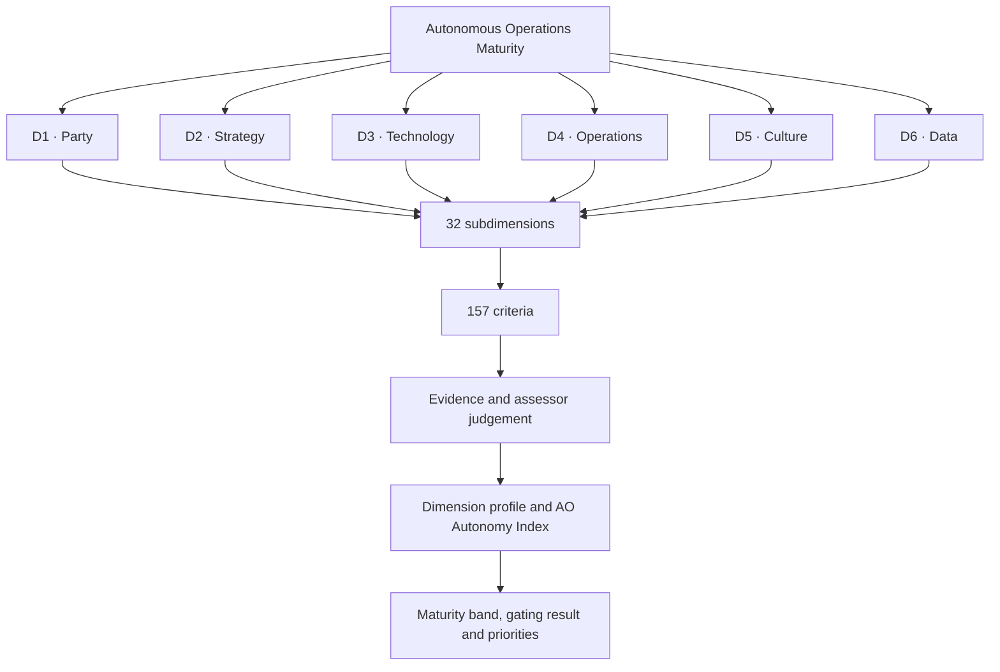
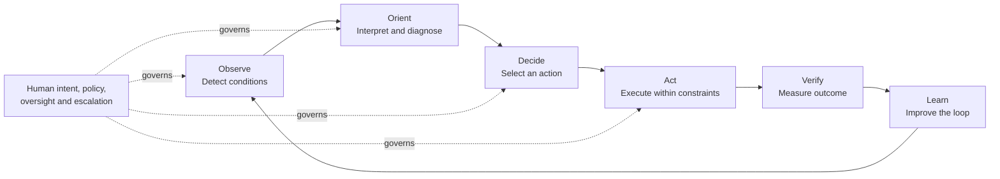
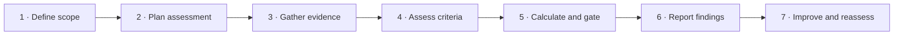

# Autonomous Operations Maturity Model

**Model ID:** `dea:maturity-autonomous-operations`  
**Repository release:** `2.0.0` · **License:** MIT · **Conformance:** Structural

The Autonomous Operations Maturity Model assesses an enterprise's ability to operate value streams through **intent-driven, governed, closed-loop execution**. It examines how operational systems progress from human-led activity and isolated automation toward adaptive, increasingly autonomous operations in which systems can observe conditions, interpret them, decide within declared constraints, act, verify outcomes and improve from feedback.

The model assesses the maturity of the **operating model and its capabilities**, not the number of AI tools deployed or the volume of tasks automated. Technology is necessary, but autonomy also depends on strategy, governance, operating practices, data, organizational culture, stakeholder experience and effective human oversight.

---

## Navigate the model

| If you are a... | Start here |
|---|---|
| Board member, executive or business sponsor | [What the model tells you](#what-the-model-tells-you) and [Interpreting results](#maturity-progression-and-results) |
| COO, operations leader or value-stream owner | [What is assessed](#what-the-model-assesses), [Assessment approach](#how-to-run-an-assessment) and the [Quickstart](docs/QUICKSTART.md) |
| Transformation or autonomy programme leader | [How the model is structured](#model-architecture) and [Using results to set priorities](#using-results-to-set-priorities) |
| Enterprise, solution or technology architect | [Dimension coverage](#the-six-assessment-dimensions) and the [Model guide](docs/MODEL-GUIDE.md) |
| Data, AI, automation or platform leader | [Technology and Data dimensions](#the-six-assessment-dimensions), [Evidence and scoring](#evidence-and-scoring) |
| Risk, security, governance or assurance professional | [Governance and human oversight](#governance-human-oversight-and-assurance) and [Evidence and scoring](#evidence-and-scoring) |
| Assessor or assessment team | [Assessment approach](#how-to-run-an-assessment), [Quickstart](docs/QUICKSTART.md) and [Worked example](docs/WORKED-EXAMPLE.md) |
| Model contributor or maintainer | [Repository contents](#repository-contents) and [Governance and contribution](#governance-and-contribution) |

## What the model tells you

The model provides an evidence-led view of whether an organization can reliably operate and improve autonomous value streams. It helps answer questions such as:

- Are operational processes instrumented well enough to observe service, resource and business conditions?
- Can the organization interpret events and identify causes rather than merely detect symptoms?
- Which decisions can be delegated to automated systems or agents, and within what policy, risk and authority boundaries?
- Can systems execute corrective or value-generating actions, verify their outcomes and learn from results?
- Are data, architecture, governance, people and operating practices mature enough to sustain autonomy safely?
- Where are the constraints that prevent a closed loop from operating end to end?

The result is not simply an automation score. It is a view of the enterprise's ability to **delegate operational decisions and actions responsibly**, with evidence that the resulting outcomes remain controlled, measurable and aligned to intent.

### What this model is, and is not

| This model assesses | This model does not replace |
|---|---|
| Enterprise operating-model maturity for autonomous operations | A general digital transformation assessment |
| Closed-loop operational capability and the conditions that enable it | A general AI adoption or AI readiness assessment |
| Governance, delegation, human oversight and assurance of autonomous execution | Technical product certification or AI model evaluation |
| Progression from manual and assisted activity to adaptive autonomy | A detailed assessment of every individual technology or solution |
| Evidence of capability across the declared assessment scope | A guarantee of future operational or financial outcomes |

## Model architecture

The model is organized into six dimensions, 32 subdimensions and 157 assessment criteria. Criteria provide the assessable units; evidence supports the criterion-level judgement; dimension and enterprise-level aggregation provide the resulting maturity profile.

The model's progression logic is grounded in the OODA control cycle: **Observe, Orient, Decide and Act**. The four stages describe the operational loop; the six dimensions assess the broader enterprise capabilities needed to make those loops effective, governed and sustainable.

The OODA spine is the model's distinguishing operational logic. Verification and learning reinforce the loop, while human intent, policy, oversight and escalation establish the conditions under which autonomy is permitted.

## The six assessment dimensions

The six dimensions provide complementary views of the enterprise conditions and capabilities required for autonomous operations. Their weights are the default aggregation profile.

| Dimension | Weight | Subdimensions | Criteria | Assessment focus |
|---|---:|---:|---|---|
| **D1 · Party** | 15% | 7 | 41 | Customer, partner, employee and smart-things engagement, experience, insight and trust |
| **D2 · Strategy** | 20% | 5 | 22 | Value model, business architecture, financial management, governance and sustainability |
| **D3 · Technology** | 20% | 4 | 22 | Autonomy capabilities, architecture, resources and agent lifecycle |
| **D4 · Operations** | 20% | 6 | 25 | Closed-loop operational flows across anomaly management, assurance, complaints, value uplift, net-zero and fulfillment |
| **D5 · Culture** | 10% | 5 | 19 | Innovation, quality culture, culture management, organizational alignment and workplace enablement |
| **D6 · Data** | 15% | 5 | 26 | Data lifecycle, quality, security, governance and value realization |
| **Total** | **100%** | **32** | **157** | |

The dimension names, subdimension structure and criterion definitions are maintained in the model register. See [the model guide](docs/MODEL-GUIDE.md) for the dimension narratives and examples.

### The closed-loop operational spine

Four criteria in the Operations dimension are designated as gating criteria:

| Criterion | OODA stage | Capability being assessed |
|---|---|---|
| 4.1.1 | Observe | Detect anomaly or relevant operational event |
| 4.1.2 | Orient | Demarcate the event and locate its root cause |
| 4.1.3 | Decide | Determine the appropriate response |
| 4.1.4 | Act | Execute the response within the defined authority and constraints |

These criteria are mandatory within an applicable assessment scope. The weakest in-scope gating criterion caps the organization's resolved maturity band. This prevents strong performance elsewhere from concealing a break in the operational loop. A criterion excluded from the declared scope does not gate the result; the scope and exclusions must be recorded.

## Maturity progression and results

The five capability levels describe increasing maturity in the establishment, consistency, automation and autonomy of assessed capabilities. They align one-to-one with the canonical maturity bands.

| Level | Capability level | Canonical band | AO progression interpretation |
|---|---|---|---|
| L-1 | Absent | 1 · Emergent (0–20) | Manual and reactive; people perform the operational loop |
| L-2 | Initial | 2 · Structured (21–45) | Instrumented and assisted; systems provide observations, people retain orientation and decisions |
| L-3 | Defined | 3 · Systematic (46–70) | Closed-loop automation within defined rules; people establish goals and handle exceptions |
| L-4 | Automated | 4 · Adaptive (71–88) | Goal-driven autonomy; agents decide and act within guardrails, with human governance and audit |
| L-5 | Autonomous | 5 · Self-Optimising (89–100) | Self-improving ecosystem; coordinated loops adapt within declared intent and governance |

**L-0 · Not Assessed** is a separate assessment state, not a capability maturity level. It indicates that evidence was not examined for the criterion. Under the current evaluation specification it receives zero points and affects evidence confidence. It must not be interpreted as a finding that the capability is absent; that judgement is represented by L-1.

The scale's definitions and point mappings are authoritative in [maturity/scale.yaml](maturity/scale.yaml) and [maturity/evaluation.yaml](maturity/evaluation.yaml).

### How the result is calculated

The current evaluation specification defines this sequence:

1. **Score criteria:** assess each in-scope criterion against the L-1 to L-5 anchors. Record L-0 only when the criterion was not assessed.
2. **Calculate dimension scores:** take the unweighted mean of criterion points within each dimension.
3. **Calculate the AO Autonomy Index:** calculate the weighted mean of the dimension scores using the selected weight profile.
4. **Resolve the maturity band:** map the index to the canonical band ranges.
5. **Apply the weakest-link gate:** cap the resolved band at the lowest in-scope gating criterion's band.
6. **Report the assessment:** publish the index, gated band, AO progression stage, dimension profile, evidence confidence, effort-adjusted value, findings and improvement priorities.

The default dimension weights are Strategy 20%, Operations 20%, Technology 20%, Party 15%, Data 15% and Culture 10%. A separate `comms-provider` profile is available for communications providers and assigns 25% to Operations and 15% to Strategy; the remaining weights are unchanged. The selected profile must be recorded so that results can be interpreted and compared appropriately.

The effort-adjusted value is calculated as the AO Autonomy Index multiplied by the effort multiplier associated with the resolved band. It is a supplementary planning indicator, not a maturity score, a financial valuation or a measure of realized benefits.

## Evidence and scoring

The model is designed for evidence-led assessment. A score should be supported by observable practices, operational records or other artifacts that demonstrate the capability within the declared scope.

Evidence may include:

- Operational telemetry, observability dashboards, event and incident records.
- Agent and automation action logs, decision traces and execution records.
- Policies, control definitions, delegation rules, approval and escalation records.
- Architecture, integration, data lineage and lifecycle documentation.
- Service-level objectives, error budgets, performance and outcome measures.
- Runbooks, operational procedures, post-incident reviews and improvement records.
- Stakeholder, customer and employee feedback relevant to the assessed capability.

Each criterion should have a recorded score, rationale and supporting evidence. An independent assessor should verify a sample of evidence. Self-attestation alone is not sufficient to establish high confidence.

### Evidence confidence

The evaluation specification defines confidence using the proportion of criteria supported by independently verified evidence:

| Confidence | Current rule |
|---|---|
| **High** | At least 80% independently verified |
| **Medium** | 50–79% independently verified |
| **Low** | Below 50%, or self-attested only |

Confidence is reported alongside the maturity result. It qualifies how much reliance should be placed on the assessment; it is not a substitute for the maturity score.

## How to run an assessment

A defensible assessment begins with a clear scope and ends with a prioritized improvement plan.

1. **Define the scope.** Identify the organization, value streams, services, domains and scenarios being assessed. Record exclusions and the selected weight profile.
2. **Plan the assessment.** Identify stakeholders, assessors, evidence owners and the assessment period. Include all applicable gating criteria.
3. **Gather evidence.** Collect evidence for each criterion and record its source, period, scope and verification status.
4. **Assess criteria.** Evaluate observable capability against the level anchors. Record rationale and confidence.
5. **Calculate and apply the gate.** Follow the evaluation specification and validate the aggregation and gating results.
6. **Report findings.** Present the AO Autonomy Index, gated band, dimension profile, evidence confidence, closed-loop constraints and improvement opportunities.
7. **Improve and reassess.** Translate gaps into owned initiatives, track outcomes and repeat the assessment on a consistent cadence. Quarterly reassessment is recommended, with additional assessment after material changes to autonomous loops or agents.

For a facilitated pilot on one value stream, use the [Quickstart](docs/QUICKSTART.md). A pilot is useful for learning the instrument and identifying likely constraints; it should not be represented as a full-model benchmark.

## Using results to set priorities

The maturity result is most useful when read as a profile rather than as a single headline number.

- **Start with the gate.** If the weakest-link gate caps the result, address the lowest in-scope gating stage before optimizing already-strong dimensions.
- **Inspect the dimension profile.** Identify structural weaknesses in strategy, technology, data, culture or party experience that may prevent operational autonomy from scaling.
- **Connect findings to outcomes.** Prioritize improvements by their effect on service performance, risk, cost, experience, resilience and value realization.
- **Separate capability from tooling.** A new platform or agent does not establish maturity unless the operating capability, governance and evidence demonstrate the intended behavior.
- **Track progression over time.** Keep scope, profile, evidence standards and assessment method consistent when comparing results across periods.

The [worked example](docs/WORKED-EXAMPLE.md) demonstrates index aggregation and the effect of the weakest-link gate.

## Governance, human oversight and assurance

Autonomous operations does not mean unbounded machine authority. The model treats governance, delegation, escalation, auditability and human oversight as material capabilities.

A mature operating model makes explicit:

- The intent and outcomes an autonomous loop is permitted to pursue.
- Policies, constraints, risk tolerances and delegated decision authority.
- Conditions that require human approval, intervention or escalation.
- Traceability of autonomous decisions and actions.
- Verification that actions achieved their intended outcomes and remained within constraints.
- Learning and change controls that prevent feedback from silently weakening safety or governance.

Assessment findings should distinguish between a capability that is absent, a capability that exists but is not consistently applied, and a capability for which evidence was not available.

## Relationship to other assessment models

Autonomous Operations is a specialist assessment of the enterprise operating model for closed-loop autonomy. It complements, but does not replace, broader or adjacent maturity assessments.

| Assessment question | Relevant model |
|---|---|
| How mature is the enterprise's overall digital transformation? | [Digital Transformation Maturity Model](https://github.com/Assessment-Models/maturity-model-digital-transformation) |
| How mature are operational management and reliability capabilities before or alongside autonomy? | [Operations Maturity Model](https://github.com/Assessment-Models/maturity-model-operations) |
| How mature are technology capabilities and practices? | [Technology Maturity Model](https://github.com/Assessment-Models/maturity-model-technology) |
| How mature is service delivery? | [Services Delivery Maturity Model](https://github.com/Assessment-Models/maturity-model-services-delivery) |

The Operations model and this model have a declared relationship. In particular, operational reliability evidence may inform the assessment of autonomous operations, while the distinction remains whether the capability provides reliable automation or owns a governed, intent-driven closed loop. Relationships between models do not imply equivalent criteria, scores or maturity results.

## Documentation and repository contents

| Resource | Purpose |
|---|---|
| [Quickstart](docs/QUICKSTART.md) | Run a pilot assessment on one value stream |
| [Model guide](docs/MODEL-GUIDE.md) | Understand the dimensions, criteria themes and level progression |
| [Worked example](docs/WORKED-EXAMPLE.md) | Follow scoring, band resolution and the weakest-link gate |
| [Glossary](docs/GLOSSARY.md) | Definitions of model and assessment terminology |
| [Assessment questionnaire](maturity/assessment-questionnaire.yaml) | Criterion-level assessment prompts, anchors and evidence expectations |
| [Model register](maturity/model/autonomous-operations.yaml) | Authoritative dimensions, subdimensions and criteria |
| [Maturity scale](maturity/scale.yaml) | Capability levels and definitions |
| [Evaluation specification](maturity/evaluation.yaml) | Scoring, weights, aggregation, gating and assessment method |
| [Worked example data](examples/) | Illustrative assessment and scoring records |
| [Governance](docs/GOVERNANCE.md) | Maintainer governance and change control |
| [Contribution guide](CONTRIBUTING.md) | How to propose and contribute changes |

The YAML model artifacts define the assessment instrument and its machine-readable semantics. The documentation explains how to understand and apply those artifacts.

## Governance and contribution

This model is maintained by the [Assessment-Models organization](https://github.com/Assessment-Models). Changes to model identity, dimensions, subdimensions, criteria, maturity definitions, scoring, weighting or assessment rules must follow the repository's change-control process. Documentation should describe the adopted model state and must remain aligned with the authoritative artifacts.

Contributors should:

1. Read [CONTRIBUTING.md](CONTRIBUTING.md) and the governance guidance.
2. Identify whether a proposal changes model semantics or only clarifies documentation.
3. Submit substantive model changes through the prescribed change-request process.
4. Include evidence, rationale, examples and validation updates where relevant.
5. Ensure repository validation and conformance checks pass before a change is accepted.

---

**Start with the [Quickstart](docs/QUICKSTART.md) to run a pilot, or the [Model guide](docs/MODEL-GUIDE.md) to understand the assessment dimensions in depth.**
