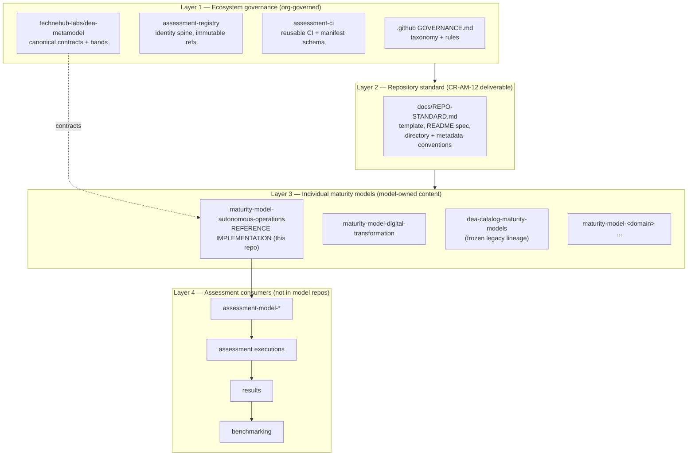
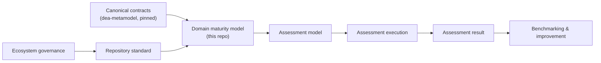

# Architecture — Assessment-Models maturity-model ecosystem (CR-AM-12)

Visual companion to `README.md`. The standard has four layers; this repository is the
Layer-3 **reference implementation**.

## Four layers



## Logical lifecycle



A maturity **model** defines maturity semantics (this repo). An assessment **model** defines how an
assessment is structured. An **execution** records an instance; a **result** records its determination.
These distinctions stay intact (CR-AM-01 decoupling): model repos never host executions, results,
or benchmarking (ADR-AM-12-09).

## This repository's place in the standard

```
maturity-model-autonomous-operations/
├── model.yaml                        # CR-AM-11 §15 contract handshake (manifest)
├── VERSION  CHANGELOG.md  CONTRIBUTING.md  LICENSE  README.md
├── maturity/
│   ├── scale.yaml                    # canonical scale, BOUND not minted (dea-metamodel)
│   ├── evaluation.yaml               # v2-band scoring + assessment method
│   ├── assessment-questionnaire.yaml # 157-criteria instrument
│   └── model/autonomous-operations.yaml  # criteria register (verbatim from lineage)
├── docs/                             # GOVERNANCE, REPO-STANDARD, ARCHITECTURE, …
├── examples/                         # worked examples (v2 band math)
├── scripts/local_validate.py         # Level 1 validator
└── .github/workflows/                # Level 1 local CI + Level 2 contract conformance
```
