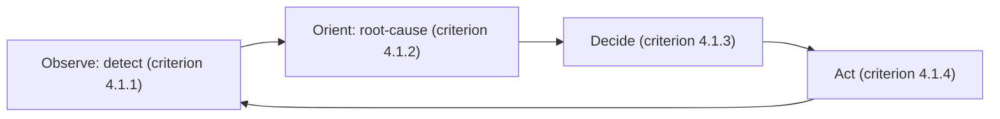

# Model guide: what the Autonomous Operations Maturity Model actually measures

This guide is the narrative companion to the machine-readable artifacts. The criteria register (`maturity/model/autonomous-operations.yaml`) is authoritative; this document explains what each dimension is asking, what the levels look like in practice, and what actually moves a score.

## The one idea behind the whole model

Automation executes predefined rules faster. **Autonomy** means the system perceives, orients, decides, and acts toward a goal within governance constraints. Every closed loop the model assesses is an OODA loop:

Maturity levels are defined by **who owns each OODA stage**. At L-1 humans do all four. At L-5 the loop self-learns and humans govern values. Everything else in the model, all 157 criteria, exists to make that shift safe, governed, observable, and valuable.

The four spine criteria (4.1.1 to 4.1.4) are **gating**: your organization's band cannot exceed the band of your lowest one. This is deliberate. An organization that detects anomalies beautifully but still needs a human to decide and act everything is, in AO terms, Instrumented & Assisted, whatever its averages say.

## The scale, in practice

| Level | Name | Band | Definition (from the scale) | What it looks like on the floor |
|---|---|---|---|---|
| L-0 | Not Assessed | — | No evidence examined; 0 points; not a capability level | Not assessed; lowers evidence confidence; never inflates the index |
| L-1 | Absent | 1: Emergent | No recurring practice or owner | People improvise; nothing survives the person who does it |
| L-2 | Initial | 2: Structured | Isolated; success depends on individuals | A hero with scripts and dashboards; no shared vocabulary |
| L-3 | Defined | 3: Systematic | Documented, agreed, consistently applied in scope | Runbooks people actually follow; governance exists but is enforced by people |
| L-4 | Automated | 4: Adaptive | Tooling enforces the practice | The pipeline rejects non-compliant changes; decision support is embedded in systems |
| L-5 | Autonomous | 5: Self-Optimising | Executes within governance constraints; humans intervene on exception | Agents act inside guardrails, every action logged and auditable, feedback changes behavior |

**Numbering note:** scale levels (what you score) align one-to-one with canonical bands (what the index resolves to): L-3 sits in band 3 Systematic. L-0 is Not Assessed: no evidence examined, 0 points, not a capability level. Results recorded before the renumbering ([dea-metamodel #214](https://github.com/technehub-labs/dea-metamodel/issues/214)) keep their index and band; only the per-criterion level label shifts by one.

## Dimension 1: Party (7 sub-dimensions, 42 criteria)

**What it asks:** when customers, partners, employees, and even smart things engage with you, how much of that engagement is proactive, personalized, and handled autonomously, and does the party experience it as effortless and trustworthy?

**Sub-dimensions** include Customer Engagement, Customer Experience, Customer Insight, the employee engagement and collaboration sub-dimension, and Smart Things Engagement, alongside the partner and party-trust sub-dimensions (see the register for the authoritative list).

**A real criterion at each end of the spectrum:**

> **1.1.1 Predictive Engagement:** the organization uses intelligent automation and customer insights (behavioral data, user profiles) to proactively anticipate customer needs and dynamically determine the right target, channel, and timing.

> **1.7.2 Self-Healing:** sensors monitor equipment health, predict failures, and trigger corrective actions automatically to minimize downtime.

**L-1 vs. L-5:** at L-1, engagement is reactive and manual; offers are built per segment, if at all, and smart things phone home to a human. At L-5, engagement anticipates need across channels, journeys self-optimize from real-time quality-of-experience data, and machines onboard, heal, and adapt with human involvement only on exception.

**What moves the score:** closed-loop personalization with consent records; autonomous support resolution at or above agent-assisted quality; machine-to-machine onboarding and healing with safety protocols.

## Dimension 2: Strategy (5 sub-dimensions, 23 criteria)

**What it asks:** is autonomous operations a managed investment with a value model, or a collection of pilots? Is there a vision, a business architecture linking intent to execution, financial management, governance, and sustainability targets applied to AO?

**Sub-dimensions:** Value Model (2.1), Business Architecture (2.2), Financial Management (2.3), Governance (2.4), Sustainability Management (2.5).

**Real criteria that carry the theme:**

> **2.1.4 Business Case:** business cases justify AO initiatives by outlining benefits, costs, and risks of alternatives, providing a reasoned foundation for investment approval.

> **2.4.7 Autonomous Action Guardrails, Escalation & Audit:** autonomous actions are bounded by policy guardrails with defined delegation and escalation paths; every autonomous decision is logged, explainable, and auditable by an independent assessor. (Added in the revamp, sourced from Forrester AEGIS, ETSI ZSM delegation and escalation patterns, and Cisco policy-governed autonomy.)

**What moves the score:** a value-operations framework mapping value propositions to operating units; benefits tracked to realized outcomes, not business-case promises; guardrails that are enforced, not written.

## Dimension 3: Technology (4 sub-dimensions, 23 criteria)

**What it asks:** do you have the autonomy capabilities, architecture, resources, and lifecycle management to run agents as production assets?

**What that means concretely:** an agent in this model is a production asset with a lifecycle: onboard, version, monitor, roll back, kill-switch. Architecture criteria cover whether loops integrate with observability and data platforms rather than bolting on. Resource criteria cover whether autonomy work has owners and funding. Lifecycle criteria cover whether agents are versioned and auditable like any other production system.

**L-1 vs. L-5:** at L-1, automation is scripts on a scheduler with no owner. At L-5, multi-agent coordination runs with simulation-before-act for consequential decisions, and every autonomous action is logged and auditable.

## Dimension 4: Operations (6 sub-dimensions, 27 criteria)

**What it asks:** are your operational flows actually closed loops? The sub-dimensions map to flow families: anomaly management, assurance, complaints, value uplift, net-zero, and fulfillment.

**This dimension holds the gating spine**, criteria 4.1.1 (detect), 4.1.2 (root-cause), 4.1.3 (decide), 4.1.4 (act). They are scored like any other criterion but cap the organization's band: your maturity is the maturity of your weakest OODA stage, in scope.

**What moves the score:** telemetry with service level objectives and error budgets; automated root-cause that shortens Orient; decisioning within declared rules; remediation executed without human dispatch for the declared blast radius.

## Dimension 5: Culture (5 sub-dimensions, 20 criteria)

**What it asks:** does the organization absorb autonomous operations, or does it sponsor it on paper? Covers innovation practice, quality culture, culture management, alignment, and workplace enablement.

**What that means concretely:** employees actively adopt intelligent automation in daily work and make data-driven decisions; improvement ideas flow through AO-enabled feedback loops with measured implementation impact; collaboration is increasingly agent-mediated.

**Why it is weighted 0.10 but still matters:** culture rarely gates a single assessment, but a low Culture score predicts stalled adoption between assessments. Treat a weak culture score as a leading indicator, not a footnote.

## Dimension 6: Data (5 sub-dimensions, 22 criteria)

**What it asks:** can data be trusted end to end? Covers the data lifecycle, quality, security, governance, and value realization. It is the , because every OODA stage consumes data: a loop that observes bad data orients confidently in the wrong direction.

**What moves the score:** lifecycle management with lineage; quality measured at the point the loop consumes it; security and governance enforced as policy; value realization meaning data investments trace to loop outcomes.

## Glossary

All terms are defined in [docs/GLOSSARY.md](docs/GLOSSARY.md). The four you will use most:

- **OODA loop:** Observe, Orient, Decide, Act; the progression axis of the model.
- **Gating criterion:** one of 4.1.1 to 4.1.4; the lowest in-scope one caps the organization's band (the weakest-link gate).
- **AO Autonomy Index:** the 0-100 weighted mean of dimension scores, resolved to a band.
- **Confidence:** High (at least 80% independently verified), Medium (50-79%), Low (below 50% or self-attested).