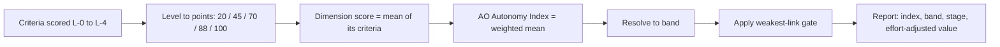

# Quickstart: run a pilot assessment in about 60 minutes

This guide gets you from zero to a scored, interpreted result on **one value stream** in a single session. It is a pilot: it uses a representative slice of the criteria, light evidence, and hand arithmetic. It will not produce a publishable benchmark, but it will show you exactly how the model works, what your weakest loop is, and whether a full assessment is worth committing to.

## What you need

- This repository (for `maturity/scale.yaml` level anchors and `maturity/assessment-questionnaire.yaml`).
- Three to five people in the room (or call): the value-stream owner, an operations or platform engineer, and someone close to the data.
- Access, at least on screen, to: telemetry or observability dashboards, incident records, automation or agent logs, and any runbooks.

## Step 1: write a one-paragraph scope charter (5 min)

Copy this template and fill it in. The scope charter is a required input for any assessment; the pilot is no exception.

```text
Scope charter (pilot)
- Value stream in scope: e.g. trouble-to-resolve
- Scenarios included: e.g. fixed-line consumer faults
- Explicitly excluded: e.g. enterprise services, field dispatch
- Weight profile: default (use comms-provider only if you are a CSP)
- Date and participants: ...
- Assessor: named person independent of the evidence owners
```

## Step 2: select your criteria slice (5 min)

From the questionnaire, select roughly 22-28 criteria:

- **Mandatory:** all four gating criteria, 4.1.1 (detect), 4.1.2 (root-cause), 4.1.3 (decide), 4.1.4 (act). A pilot without them cannot produce a valid band.
- **Then:** three to four criteria per dimension, favoring ones you can produce evidence for today.

A full assessment scores all 157 criteria; the slice is a pilot convenience only.

## Step 3: gather light evidence (25 min)

Work through the slice as a structured conversation. For each criterion, read its `what_to_observe` aloud, then ask: what do we have that shows this exists? Screenshots, dashboard exports, incident samples, and agent action logs are all fine at pilot fidelity. Note every claim that is self-attested rather than shown; it will drag confidence down later, and it should.

## Step 4: score each criterion (15 min)

Score against the level anchors, not gut feel:

| Level | Name | Resolves to band | Anchor |
|---|---|---|---|
| L-0 | Absent | 1: Emergent | No recurring practice, no owner |
| L-1 | Initial | 2: Structured | Isolated, person-dependent success |
| L-2 | Defined | 3: Systematic | Documented, agreed, consistently applied in scope |
| L-3 | Automated | 4: Adaptive | Tooling enforces the practice; governance is tool-integrated |
| L-4 | Autonomous | 5: Self-Optimising | Executes within governance constraints; humans intervene only on exception |

Watch the numbering offset: levels count from zero, canonical bands from one, so an L-2 criterion resolves to band 3. Record level and band together and the trap disappears.

Record per criterion: level (L-0..L-4), confidence (High / Medium / Low), and a one-line rationale.

## Step 5: compute the result by hand (10 min)

The scoring pipeline:



1. **Level to points:** L-0 = 20, L-1 = 45, L-2 = 70, L-3 = 88, L-4 = 100.
2. **Dimension score:** the mean of your slice's criteria within each dimension.
3. **AO Autonomy Index:** weighted mean using the default profile: Strategy 0.20, Operations 0.20, Technology 0.20, Data 0.15, Party 0.15, Culture 0.10.
4. **Resolve the band:** Emergent (0-20), Structured (21-45), Systematic (46-70), Adaptive (71-88), Self-Optimising (89-100).
5. **Apply the gate:** find your lowest-scored gating criterion. Your organization's band cannot exceed that criterion's band.
6. **Effort-adjusted value:** index × the resolved band's effort multiplier (1.0x / 1.5x / 2.5x / 4.0x / 6.0x).

**Illustrative pilot arithmetic** (trouble-to-resolve, default profile, slice of 24 criteria):

| Dimension | Pilot dimension score | Weight | Contribution |
|---|---|---|---|
| Party | 42 | 0.15 | 6.30 |
| Strategy | 55 | 0.20 | 11.00 |
| Technology | 50 | 0.20 | 10.00 |
| Operations | 48 | 0.20 | 9.60 |
| Culture | 35 | 0.10 | 3.50 |
| Data | 44 | 0.15 | 6.60 |
| **AO Autonomy Index** | | | **47.0** |

The index lands in Systematic (46-70). But the gating slice scored 4.1.1 at L-1, 4.1.2 at L-1, 4.1.3 at L-2, 4.1.4 at L-1: the lowest gating level is L-1, which is the Structured band. **The gate caps the result: org band = Structured, AO stage = Instrumented & Assisted, effort-adjusted value = 47 × 1.5 = 70.5.**

That cap is the pilot's main finding: detection tooling exists (L-1/L-2 on observe), but deciding and acting are still human-led. The frontier is the act stage of the loop, not any dimension average.

## Step 6: decide what to do with it

- **Band vs. gate:** if the gate caps you, the roadmap starts by closing the lowest gating stage, not by polishing your strongest dimension. Moving one gating criterion one level can lift the whole band.
- **Within 30 days:** deep-dive your lowest dimension and the gating criteria with real evidence; decide whether to commission a full assessment.
- **Full assessment:** all 157 criteria, evidence pack per criterion, independent assessor verification, published report, quarterly reassessment. Follow `maturity/evaluation.yaml` and the questionnaire.

## What a pilot is not

- **Not a benchmark.** The slice is chosen for evidence availability, not representativeness; do not compare pilot indices across teams or organizations.
- **Not high confidence.** Pilots are mostly self-attested; confidence will be Medium at best, and that cap is by design.
- **Not a waiver on the gate.** The weakest-link gate applies from the smallest pilot upward; a strong average never overrides a broken loop.